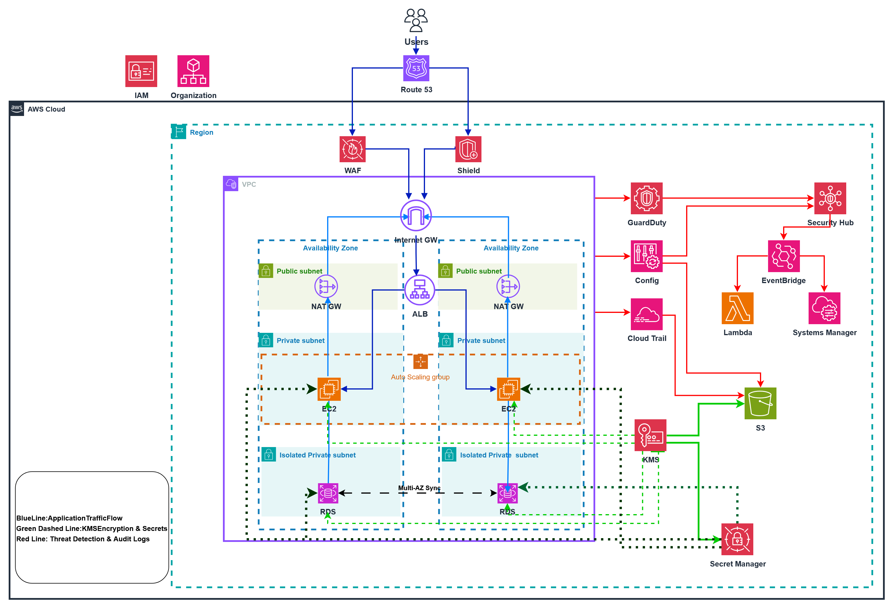

# Secure Multi-Tier Architecture with GuardDuty, KMS & Security Hub

## Table of Contents

- [Overview](#overview)
- [Architecture Diagram](#architecture-diagram)
- [Security Layers and Key AWS Services](#security-layers-and-key-aws-services)
- [Repository Structure](#repository-structure)
- [Prerequisites](#prerequisites)
- [Deployment Walkthrough](#deployment-walkthrough)
- [Testing and Validation](#testing-and-validation)
- [Cost Management and Cleanup](#cost-management-and-cleanup)
- [Notes and Limitations](#notes-and-limitations)
- [License](#license)
- [Author](#author)

---

## Overview

This solution implements a **Defense-in-Depth** security architecture for a highly available, three-tier web application (Web, Application, and Data tiers) on AWS. Built in alignment with the **AWS Well-Architected Framework (Security Pillar)**, the architecture enforces encryption at rest and in transit, automated credential rotation, continuous threat detection, compliance auditing against the **CIS AWS Foundations Benchmark** and **PCI DSS**, and automated incident response.

| Security Pillar area | How this project addresses it |
|---|---|
| Identity and access management | Least-privilege IAM roles, a permission boundary, a deny-root SCP, and database credentials that rotate automatically |
| Detection | CloudTrail (all Regions), GuardDuty, AWS Config, Security Hub |
| Infrastructure protection | Multi-AZ VPC with public, private, and isolated subnets, chained Security Groups, WAF, Shield Standard, VPC endpoints, and no inbound SSH/RDP |
| Data protection | KMS customer managed keys, TLS in transit (ACM on the ALB, SSL-only RDS, TLS-only S3 buckets), Secrets Manager |
| Incident response | EventBridge and Lambda auto-remediation of risky Security Group rules |

---

## Architecture Diagram



Editable source: [`secure-3tier-architecture.drawio`](./architecture/secure-3tier-architecture.drawio) (open it with [diagrams.net](https://app.diagrams.net)).

**How to read the diagram**

| Line | Meaning |
|---|---|
| Blue | Application traffic flow |
| Green dashed | KMS encryption and secrets access |
| Red | Threat detection and audit logs |
| Gray dashed | WAF and Shield protection attached to the ALB |

**Request flow:** Users → Route 53 → Internet Gateway → ALB (HTTPS, protected by WAF and Shield) → EC2 instances in an Auto Scaling group (private subnets) → RDS Multi-AZ (isolated subnets). Instances reach the internet only through the NAT Gateways, and reach AWS APIs through VPC endpoints.

---

## Security Layers and Key AWS Services

### 1. Network Isolation and Edge Protection
* **Amazon VPC (Multi-AZ):** Segmented into Public Subnets (ALB and NAT Gateways), Private Subnets (Application Tier EC2 instances), and Isolated Private Subnets (RDS Multi-AZ Database) across two Availability Zones. Isolated subnets have no route to the internet.
* **Security Groups (chained):** Each tier accepts traffic only from the tier in front of it, and no Security Group allows inbound SSH or RDP (see the table below).
* **AWS WAF:** A Web ACL associated with the ALB (a regional association) using AWS managed rule groups (`AWSManagedRulesCommonRuleSet`, `AWSManagedRulesSQLiRuleSet`, `AWSManagedRulesKnownBadInputsRuleSet`) plus a rate-based rule, to mitigate common OWASP Top 10 attack patterns such as SQL injection and cross-site scripting.
* **AWS Shield Standard:** Always-on protection against common network and transport layer DDoS attacks, enabled automatically for the ALB and Route 53.
* **VPC Endpoints:** Interface endpoints for Secrets Manager, KMS, and Systems Manager (`ssm`, `ssmmessages`, `ec2messages`), plus an S3 gateway endpoint, so private and isolated subnets reach AWS APIs without an internet path.
* **AWS Systems Manager (Session Manager):** Replaces traditional SSH/RDP bastion hosts, allowing auditable shell access with zero inbound ports open (`0.0.0.0/0` blocked). Session activity can be logged to an encrypted CloudWatch Logs group or S3 bucket.

**Security Group design**

| Security Group | Inbound | Source |
|---|---|---|
| `alb-sg` | 80 (redirect only) and 443 | `0.0.0.0/0` |
| `app-sg` | Application port (for example 8080) | `alb-sg` only |
| `db-sg` | Database port (3306 or 5432) | `app-sg` and `rotation-sg` |
| `endpoints-sg` | 443 | `app-sg` and `rotation-sg` |
| `rotation-sg` | None | Outbound to `db-sg` (database port) and `endpoints-sg` (443) |

### 2. Identity, Governance and Encryption
* **AWS Organizations and SCPs:** Enforces guardrails on member accounts, including an explicit Service Control Policy ([`deny-root-scp.json`](./policies/deny-root-scp.json)) that denies all actions by the root user. SCPs do not apply to the management account, so protect that account's root user with MFA and no access keys.
* **IAM Least Privilege and Permission Boundary:**
  * [`least-privilege-app-role.json`](./policies/least-privilege-app-role.json): EC2 application role that can read one secret and decrypt it only through Secrets Manager.
  * [`lambda-remediation-role.json`](./policies/lambda-remediation-role.json): Lambda execution role that can describe Security Groups, revoke ingress rules in this account, and write its own logs.
  * [`permission-boundary.json`](./policies/permission-boundary.json): upper limit for workload roles. It also explicitly denies tampering with CloudTrail, GuardDuty, Security Hub, AWS Config, KMS key deletion, and any IAM or Organizations change.
* **AWS KMS (Customer Managed Keys - CMKs):** One CMK governed by [`kms-key-policy.json`](./policies/kms-key-policy.json), which separates key administrators (manage, cannot use) from key users (use, cannot manage). Automatic key rotation is enabled. RDS, EBS, and Auto Scaling use KMS grants, so the Auto Scaling service-linked role is allowed in the key policy. The CMK encrypts Amazon RDS, EBS volumes, S3 audit buckets, Secrets Manager secrets, and Systems Manager Parameter Store `SecureString` values.
* **AWS Secrets Manager:** Stores database credentials securely and rotates them automatically every 30 days with a Lambda rotation function that runs inside the VPC (it reaches the database in the isolated subnets and Secrets Manager through a VPC endpoint). Every secret access is recorded by CloudTrail.
* **Encryption in transit:** An ACM certificate on the ALB HTTPS listener with an HTTP-to-HTTPS redirect and a TLS 1.2+ security policy, SSL-only connections to RDS, and S3 bucket policies that deny requests made without TLS (`aws:SecureTransport`).

### 3. Threat Detection and Compliance Auditing
* **AWS CloudTrail:** Multi-Region API activity logging delivered to an encrypted (SSE-KMS), versioned S3 bucket with log file integrity validation enabled.
* **Amazon GuardDuty:** Continuous threat intelligence monitoring for reconnaissance (`Recon`), backdoor (`Backdoor`), cryptocurrency mining (`CryptoCurrency`), compromised instances, and unusual API calls.
* **AWS Config:** Tracks configuration drift and evaluates resource compliance with managed rules such as `restricted-ssh`, `restricted-common-ports`, `s3-bucket-public-read-prohibited`, `encrypted-volumes`, and `rds-storage-encrypted`.
* **AWS Security Hub:** Aggregates findings from GuardDuty and AWS Config into a single dashboard with the **CIS AWS Foundations Benchmark** and **PCI DSS** standards enabled.

### 4. Automated Incident Response
* **Amazon EventBridge and AWS Lambda:** An EventBridge rule ([`eventbridge-rule-pattern.json`](./remediation/eventbridge-rule-pattern.json)) matches AWS Config compliance changes for Security Groups that become `NON_COMPLIANT` and triggers [`auto_remediate_sg.py`](./remediation/auto_remediate_sg.py). The function removes only the world-open (`0.0.0.0/0` and `::/0`) entries that expose SSH (22), RDP (3389), or all traffic, including entries inside port ranges, and keeps every trusted CIDR in the same rule. The function accepts both AWS Config and Security Hub finding events.
* **AWS Systems Manager Automation (optional):** The same EventBridge rule, or the AWS Config rule's remediation action, can also start an Automation runbook. AWS provides managed runbooks for this, for example `AWS-DisablePublicAccessForSecurityGroup`. AWS documents that this runbook can fail with `InvalidPermission.NotFound` on Security Groups in non-default VPCs whose rules do not match its expected patterns, which is why the custom Lambda is the primary remediation here.

---

## Repository Structure

```text
├── architecture/
│   ├── secure-3tier-architecture.png      # Architecture diagram (PNG with the draw.io source embedded)
│   └── secure-3tier-architecture.drawio   # Editable draw.io source file
├── policies/
│   ├── deny-root-scp.json                 # SCP: deny all root user actions in member accounts
│   ├── kms-key-policy.json                # CMK key policy (admins, app role, Auto Scaling, CloudTrail)
│   ├── least-privilege-app-role.json      # EC2 application role permissions
│   ├── lambda-remediation-role.json       # Remediation Lambda execution role permissions
│   └── permission-boundary.json           # Permission boundary for workload roles
├── remediation/
│   ├── auto_remediate_sg.py               # Python (Boto3) Lambda for automated threat remediation
│   └── eventbridge-rule-pattern.json      # EventBridge pattern: non-compliant Security Groups
├── LICENSE                                # MIT License
└── README.md                              # Project documentation and deployment guide
```

---

## Prerequisites

* An AWS account (preferably a member account of an AWS Organization, so the SCP can be tested) and an administrator IAM role or user protected by MFA.
* AWS CLI v2 configured (`aws configure`) for the validation commands.
* A domain name you control (Route 53 or external) to issue the ACM certificate. Without one, the HTTPS parts can only be documented, not tested.
* **Region:** every JSON policy in this repository is written for `us-east-1`. If you deploy elsewhere, change the Region in the ARNs and in the `kms:ViaService` values.
* **Placeholders:** replace these values before using any policy. Never commit real account IDs, key IDs, or credentials to a public repository.

| Placeholder | Used in | Replace with |
|---|---|---|
| `<ACCOUNT_ID>` | All policies | Your 12-digit AWS account ID |
| `<CMK_KEY_ID>` | `least-privilege-app-role.json` | Key ID of the KMS CMK |
| `<KEY_ADMIN_ROLE>` | `kms-key-policy.json` | IAM role that administers the key |
| `<APP_ROLE_NAME>` | `kms-key-policy.json` | Name of the EC2 application role |
| `<TRAIL_NAME>` | `kms-key-policy.json` | Name of the CloudTrail trail |
| `<FUNCTION_NAME>` | `lambda-remediation-role.json` | Name of the remediation Lambda function |

---

## Deployment Walkthrough

### Step 1: Identity and encryption foundation
* Create the IAM roles first: a key administrator role, the EC2 application role (attach the AWS managed policy `AmazonSSMManagedInstanceCore`), and the Lambda remediation role (`lambda-remediation-role.json`). Attach `permission-boundary.json` as the permissions boundary of the EC2 and Lambda roles.
* Create the Auto Scaling service-linked role if it does not exist yet: `aws iam create-service-linked-role --aws-service-name autoscaling.amazonaws.com`.
* Create the KMS CMK with `kms-key-policy.json` and enable automatic key rotation. Then add `least-privilege-app-role.json` to the EC2 application role, using the new key ID.

### Step 2: Network foundation
* Create a VPC (example: `10.0.0.0/16`) across 2 Availability Zones with Public, Private, and Isolated Subnets in each.
* Add an Internet Gateway, one NAT Gateway per Availability Zone, and route tables. The isolated subnets get no route to the internet.
* Create the Security Groups from the table above and the VPC endpoints (Secrets Manager, KMS, `ssm`, `ssmmessages`, `ec2messages`, and the S3 gateway endpoint).

### Step 3: Data tier
* Launch a Multi-AZ RDS instance in the Isolated Subnets, encrypted with the CMK, and force SSL in its parameter group (`rds.force_ssl=1` for PostgreSQL, `require_secure_transport=ON` for MySQL).
* Store the credentials in Secrets Manager (for example `prod/app/db-credentials`), encrypted with the CMK, and enable automatic rotation every 30 days using the AWS-provided RDS rotation Lambda attached to the VPC with `rotation-sg`.

### Step 4: Application tier
* Create a launch template with encrypted EBS volumes (CMK), IMDSv2 required, the EC2 application role as the instance profile, `app-sg`, and no key pair.
* Create an Auto Scaling Group across the Private Subnets with a target tracking scaling policy.

### Step 5: Edge protection
* Create an Internet-facing ALB in the Public Subnets with `alb-sg`, an ACM certificate, an HTTPS listener (TLS 1.2+ policy, for example `ELBSecurityPolicy-TLS13-1-2-2021-06`), and an HTTP listener that redirects to HTTPS.
* Associate an AWS WAF Web ACL with the ALB and add a Route 53 alias record that points to it. Shield Standard is enabled automatically.

### Step 6: Audit and detection
* Create a log bucket with versioning, Block Public Access, default KMS encryption, and a policy that denies non-TLS requests.
* Enable a multi-Region CloudTrail trail with log file validation, SSE-KMS, and the log bucket.
* Turn on AWS Config recording and add the managed rules listed above. Activate GuardDuty, then Security Hub with the CIS AWS Foundations Benchmark and PCI DSS standards.

### Step 7: Automated response
* Create the Lambda function from `remediation/auto_remediate_sg.py` (Python 3.12 or newer, handler `auto_remediate_sg.lambda_handler`, 30 second timeout) with the remediation role.
* Create an EventBridge rule with the pattern from `remediation/eventbridge-rule-pattern.json` and set the Lambda function as its target.

### Step 8: Governance guardrails
* In AWS Organizations, attach `policies/deny-root-scp.json` to the member account or its OU.

---

## Testing and Validation

| # | Test | Expected result |
|---|---|---|
| 1 | Add `0.0.0.0/0` on port 22 to a test Security Group | AWS Config marks it `NON_COMPLIANT`, the Lambda removes only the open entry, and its log shows `REMEDIATED` |
| 2 | Generate GuardDuty sample findings | Findings appear in GuardDuty and Security Hub (sample findings are labelled as samples) |
| 3 | Rotate the database secret | `LastRotatedDate` updates and CloudTrail records the `GetSecretValue` calls |
| 4 | Validate CloudTrail log integrity | `validate-logs` reports the digest files and logs as valid |
| 5 | Check encryption and key grants | RDS, EBS, and the S3 bucket report encryption, the key rotates annually, and grants exist for RDS, EBS, and Auto Scaling |
| 6 | Open the ALB over HTTP, then HTTPS | HTTP redirects to HTTPS (301) and HTTPS serves a valid ACM certificate |
| 7 | Send a SQL injection style request | WAF blocks it with HTTP 403 when the managed rule group is in Block mode |
| 8 | Connect to an instance with Session Manager | The session opens with no inbound SSH or RDP rule |
| 9 | Run any action as the root user of a member account | The request is denied by the service control policy |

```bash
# 1. Auto-remediation
aws ec2 authorize-security-group-ingress --group-id <sg-id> --protocol tcp --port 22 --cidr 0.0.0.0/0
aws ec2 describe-security-groups --group-ids <sg-id> --query "SecurityGroups[].IpPermissions"

# 2. GuardDuty sample findings
aws guardduty create-sample-findings --detector-id <detector-id> \
  --finding-types 'Recon:EC2/PortProbeUnprotectedPort' 'Backdoor:EC2/C&CActivity.B!DNS' 'CryptoCurrency:EC2/BitcoinTool.B!DNS'

# 3. Secret rotation and audit trail
aws secretsmanager rotate-secret --secret-id prod/app/db-credentials
aws secretsmanager describe-secret --secret-id prod/app/db-credentials --query "LastRotatedDate"
aws cloudtrail lookup-events --lookup-attributes AttributeKey=EventName,AttributeValue=GetSecretValue

# 4. CloudTrail log integrity
aws cloudtrail validate-logs --trail-arn <trail-arn> --start-time 2026-01-01T00:00:00Z

# 5. Encryption and key grants
aws rds describe-db-instances --query "DBInstances[].StorageEncrypted"
aws ec2 describe-volumes --query "Volumes[].Encrypted"
aws s3api get-bucket-encryption --bucket <log-bucket>
aws kms get-key-rotation-status --key-id <cmk-key-id>
aws kms list-grants --key-id <cmk-key-id>

# 6 and 7. TLS and WAF
curl -I http://<your-domain>
curl -s -o /dev/null -w "%{http_code}\n" "https://<your-domain>/?q=1%27%20OR%20%271%27%3D%271"
```

---

## Cost Management and Cleanup

The main cost drivers are the NAT Gateways, the ALB, the Multi-AZ RDS instance, EC2 instances, the WAF Web ACL and its rules, AWS Config recording, KMS keys, Secrets Manager secrets, and the Route 53 hosted zone. GuardDuty and Security Hub include a free trial, then charge by usage. Create an AWS Budget alert before you start and estimate the total with the AWS Pricing Calculator.

To avoid ongoing AWS charges after testing and demonstration, terminate resources in reverse order:
1. Delete the EventBridge rule and the remediation Lambda function, then delete the AWS Config rules and stop the recorder.
2. Disassociate and delete the WAF Web ACL, delete the Route 53 records and hosted zone, then delete the ALB, its target groups, the Auto Scaling Group, and the launch template.
3. Delete the RDS Multi-AZ instance (and its snapshots if you do not need them), then schedule deletion of the Secrets Manager secrets.
4. Delete the NAT Gateways first, then release their Elastic IPs. After that delete the VPC endpoints, subnets, route tables, Internet Gateway, and the VPC.
5. Disable GuardDuty and Security Hub, and stop CloudTrail.
6. Empty the S3 log buckets, including all object versions and delete markers, then delete them.
7. Schedule deletion for the KMS Customer Managed Key last (7 to 30 day waiting period), and detach the SCP.

---

## Notes and Limitations

* The policies contain placeholders and assume the `us-east-1` Region (see [Prerequisites](#prerequisites)).
* The SCP affects member accounts only. In a standalone account that is not part of an Organization it cannot be applied.
* The remediation function handles inbound rules that expose SSH (22), RDP (3389), or all traffic to `0.0.0.0/0` or `::/0`. Other risky ports are reported by AWS Config and Security Hub but are not removed automatically.
* Automatic remediation can remove access that someone relies on. Test it in a non-production account first, and consider a tag-based exception for approved cases.
* ACM public certificates need a domain name you control.
* The infrastructure is documented as manual steps. Infrastructure as Code (CloudFormation or Terraform) is a natural next step.

---

## License

This project is licensed under the MIT License. See the [LICENSE](./LICENSE) file for details.

---

## Author
**Eng. Saeed Elsayed Saleh**  
Cloud & Network Security Engineer  
LinkedIn: [linkedin.com/in/saeed-saleh](https://www.linkedin.com/in/saeed-saleh)
